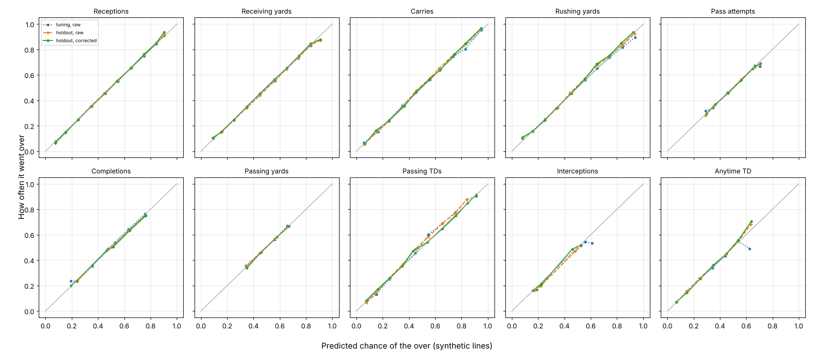

# Player props (NFL)

The player projections ([PLAYERS.md](PLAYERS.md)) give each player's expected line. This
work turns those means into calibrated chances for prop bets, over/under and anytime
touchdown, compares them with the books' prices, and flags a bet only when the edge is
real. Flags are NFL only. College lines are shown on the college board's Props section from Nov 7, 2026
(not market-tested, nothing flagged; see "The college Props section" at the end).

Code: `nflmodel/propdist.py` (distributions), `nflmodel/props.py` (the prop model),
`nflmodel/propsim.py` (same-game combinations), `nflmodel/oddsapi.py` (prices),
`nflmodel/propmarket.py` (vig, edge, EV, flags, stakes), `nflmodel/proplog.py` (the log),
`run_props.py` (the command line), `experiments/props_calibration.py` (choosing the
methods, the calibration report, the fitted parameters in `data/prop_params.json`).

**Status (Oct 27, 2026):** calibrated against outcomes (below), but **against real 2025
DraftKings and FanDuel lines the model is worse than the books**, and the sides it would
have flagged broke even. Flags are paused (`propmarket.FLAGS_ON = False`); every side is
still priced and logged. The board shows nothing new. A market-anchored blend, fitted on
2023-24 and tested on 2025 (Oct 30, 2026), did not earn them back (below).

**Market-only tags (Oct 29, 2026):** with the flags off, the Props section shows two chips
that need no model opinion (`propmarket.market_tags`): a **book gap** when DraftKings and
FanDuel post a main line a full step apart (the over at the lower line and the under at the
higher are the better numbers; a **middle** when both are −110 or better), and a **ladder gap**
when a rung's no-vig chance at a book is more than 5 points off what its own main line
implies through the model's distribution. They are kept in `data/props/prop_log_tags.csv`
by `row_id` (append-only). Nothing is flagged or staked on them; see FEATURES.md, "Edge
tests, late October 2026". **The ladder-gap chip was taken off the page on Oct 31, 2026:**
graded on the real 2025 rungs, the cheap side it pointed to lost 21.7% ± 5.2% (2,595 bets;
"Alternate ladders against real prices" below). It is still computed and logged, so its record
can be checked again; only the book-gap and middle chips are shown.

## From a mean to a chance

| Stat | Distribution |
|---|---|
| Receptions, carries, pass attempts, completions, interceptions | Negative binomial: the spread around the mean grows with the mean and depends on the size of the role (target or carry share) |
| Passing TDs, anytime TD | The same; it fits to Poisson where results vary no more than Poisson allows (passing TDs) |
| Receiving, rushing, passing yards | Volume times yards per play: the volume (receptions, carries, completions) is the count distribution above, and given n plays the yards are a gamma with n times a per-play shape. Zero plays is zero yards |

Every stat also carries a small fitted chance the player leaves early or loses his role
(injury, blowout, benching): a second component with a fraction of the usual volume. It
mostly fattens the low end. The mean is kept equal to the projection.

Outcomes are whole numbers, so lines settle the way books settle them: on a half-point line
there is no push; on a whole-number line the push chance is reported separately.

Chosen on the tuning seasons (`--select`, leave one season out), by Brier score and log
loss at the test lines:

- Counts: negative binomial with the early-exit component matched or beat Poisson, Poisson
  with exit, and negative binomial without exit on every count stat (receptions: Brier
  0.1918 against 0.1944 for plain Poisson, wide receivers; carries 0.2096 against 0.2272).
- Yards: volume times yards per play beat a gamma with a separate chance of zero for
  receivers (0.2158 against 0.2179), tight ends, quarterback rushing and passing yards
  (0.2375 against 0.2389). For running backs the two were within 0.0003 of each other;
  the compound is used for all, so every yards prop works the same way.

A monotone correction (isotonic) fitted on the tuning seasons only sits on top. It changes
almost nothing (below), because the distributions come out calibrated by themselves.

## Seasons and lines

- Tuning: 2013-2018 (the player model's tuning seasons). Each season scored with
  distribution widths fitted on the other five.
- Holdout: 2019 through week 7 of 2026, run once. Each season scored with widths fitted on
  the seasons before it (what the board would have had) and the correction fitted on the
  tuning seasons only. Nothing was changed after seeing it.
- Rows: players a book would post the prop for, chosen only on what was known before the
  game (an active player whose projection clears a minimum; quarterbacks, the projected
  starter), and the books' rule that a prop is void if the player does not play.
- **Every line here is synthetic.** There are no past prop prices. Each player-game is
  scored at the half-point line nearest his projection (yards rounded to fives, as books
  do) and one and two steps either side (1 catch or carry, 2 attempts or completions, 10
  rushing or receiving yards, 15 passing yards); touchdowns and interceptions at the
  standard 0.5, 1.5 and 2.5. Real lines enter only through the live log.

## Calibration

Brier score, lower is better. Baselines: the same distributions built on the player's
season average, and the share of his last 8 games over the line. Differences are the
model (with the correction) minus the baseline, with one standard error clustered by game.

**Holdout, 2019-2026**

| Stat | Lines | Games | Model | vs season average | vs last 8 games |
|---|---|---|---|---|---|
| Receiving yards | 131,729 | 2,067 | 0.2065 | −0.0135 ± 0.0006 | −0.0168 ± 0.0005 |
| Receptions | 131,650 | 2,067 | 0.1863 | −0.0107 ± 0.0005 | −0.0138 ± 0.0004 |
| Rushing yards | 54,288 | 2,067 | 0.2058 | −0.0123 ± 0.0009 | −0.0201 ± 0.0009 |
| Carries | 47,712 | 2,067 | 0.1989 | −0.0127 ± 0.0009 | −0.0202 ± 0.0009 |
| Passing yards | 18,340 | 2,035 | 0.2366 | −0.0244 ± 0.0021 | −0.0216 ± 0.0019 |
| Pass attempts | 18,340 | 2,035 | 0.2316 | −0.0214 ± 0.0021 | −0.0202 ± 0.0018 |
| Completions | 18,340 | 2,035 | 0.2161 | −0.0208 ± 0.0019 | −0.0188 ± 0.0015 |
| Passing TDs | 11,004 | 2,035 | 0.1807 | −0.0197 ± 0.0017 | −0.0163 ± 0.0013 |
| Interceptions | 7,336 | 2,035 | 0.1931 | −0.0212 ± 0.0019 | −0.0176 ± 0.0016 |
| Anytime TD | 39,300 | 2,067 | 0.1428 | −0.0097 ± 0.0005 | −0.0125 ± 0.0005 |

**Tuning, 2013-2018** (each season with widths fitted on the other five)

| Stat | Lines | Games | Model | vs season average | vs last 8 games |
|---|---|---|---|---|---|
| Receiving yards | 101,388 | 1,554 | 0.2100 | −0.0086 ± 0.0007 | −0.0164 ± 0.0006 |
| Receptions | 100,542 | 1,554 | 0.1896 | −0.0075 ± 0.0006 | −0.0141 ± 0.0005 |
| Rushing yards | 40,343 | 1,554 | 0.2078 | −0.0087 ± 0.0011 | −0.0175 ± 0.0011 |
| Carries | 36,147 | 1,554 | 0.2040 | −0.0100 ± 0.0012 | −0.0185 ± 0.0011 |
| Passing yards | 13,920 | 1,538 | 0.2374 | −0.0168 ± 0.0022 | −0.0220 ± 0.0022 |
| Pass attempts | 13,920 | 1,538 | 0.2326 | −0.0168 ± 0.0022 | −0.0182 ± 0.0021 |
| Completions | 13,920 | 1,538 | 0.2134 | −0.0145 ± 0.0019 | −0.0172 ± 0.0017 |
| Passing TDs | 8,352 | 1,538 | 0.1787 | −0.0163 ± 0.0018 | −0.0162 ± 0.0016 |
| Interceptions | 5,568 | 1,538 | 0.2039 | −0.0185 ± 0.0022 | −0.0187 ± 0.0020 |
| Anytime TD | 30,574 | 1,554 | 0.1402 | −0.0086 ± 0.0005 | −0.0130 ± 0.0006 |

The model beats both baselines on every stat in both periods, and at every position
(`experiments/out/props_calibration.json` has the tables by stat and position, log loss,
and the predicted-against-actual bands for each).

How often the over hit, by predicted band (holdout, corrected, a sample of the tables):

| Predicted | Receptions | Receiving yards | Rushing yards | Passing yards | Anytime TD |
|---|---|---|---|---|---|
| 10-20% | 15.1% → 14.5% | 15.1% → 14.7% | 15.7% → 15.4% | | 14.8% → 14.3% |
| 30-40% | 35.2% → 35.5% | 35.1% → 35.2% | 33.6% → 33.7% | 34.9% → 33.7% | 35.1% → 36.1% |
| 45-50% | 47.6% → 46.5% | 46.0% → 46.2% | 47.5% → 49.0% | 49.7% → 50.7% | 47.2% → 47.2% |
| 60-70% | 65.4% → 65.7% | 65.3% → 65.3% | 64.6% → 68.5% | 67.2% → 66.6% | 63.8% → 70.3% (138) |
| 80-90% | 84.3% → 84.8% | 83.5% → 84.6% | 83.2% → 84.8% | | |

Each band has thousands of lines except where a count is shown. The weakest spot is
rushing yards between 55% and 70%, which went over 1-4 points more often than predicted.

**The correction.** Isotonic, fitted on the tuning seasons. On the holdout it moves the
Brier score by less than 0.0002 on every stat, in both directions. It is kept as a guard,
not because it is doing work.

**Pushes on whole-number lines** (the integer nearest the projection; 2019 and 2025):
predicted against actual, receptions 18.8% / 19.2% (WR, 2019), passing TDs 31.2% / 31.5%,
receiving yards 1.2% / 1.1%. The weakest: running-back carries, 6.6% predicted against
8.6% in 2019 (7.5% in 2025).

**At a line set at the player's recent median** (his last 8 games, at least 4): the side
the model favours won 60-63% of the time on the holdout for yards, catches and attempts,
against a 50% coin flip. **This is not evidence the model beats books.** A recent median
is a naive line; books set theirs with the same information and more. It shows the model
knows more than a player's recent median, nothing more. The only test against real lines
is the live log.

**Not shown profitable.** None of the results above uses a price. Nothing in the tuning or
holdout seasons says these props make money.

## Against real lines: 2025

`experiments/props_real_lines.py`, on the 2025 backfill (278 games, DraftKings and
FanDuel, passing, rushing and receiving yards; two-sided markets, pushes left out, each
book's line counted separately). Distribution widths fitted on seasons before 2025.

| Snapshot | Props | Brier, ours | Brier, books (vig-free) | Ours minus books |
|---|---|---|---|---|
| Pricing (first daily run within 3 days), pregame projections | 6,217 | 0.2547 | 0.2500 | +0.0047 ± 0.0018 |
| Close (10 minutes before kickoff) | 9,138 | 0.2574 | 0.2500 | +0.0074 ± 0.0016 |

By stat at the pricing snapshot: passing yards +0.0042 ± 0.0034, receiving yards
+0.0066 ± 0.0023, rushing yards +0.0012 ± 0.0033. **The books' prices are the better
forecast, at both snapshots.** Where the model disagreed with them, the results sided
with the books: lines the model put at 60-70% went over 49% of the time (256 lines), and
lines it put at 30-40% went over 44% (1,200 lines).

**The bets the live rules would have flagged** at the pricing snapshot: 1,486 bets,
790-696, **return +0.5% ± 2.7%** against an average claimed EV of +14.9%. By stat:
passing yards −8.8% ± 6.5% (213 bets), receiving yards −0.6% ± 3.3% (820), rushing yards
+6.8% ± 4.6% (453). Two-thirds were unders. Indistinguishable from zero, and nowhere
near what the edges claimed.

**Line movement.** For those bets, the closing line moved toward the model's side 58% of
the time and away 32%, by +0.96 ± 0.10 points on average (1,484 bets). Across every prop,
on the side the model preferred, it moved toward us 47% and away 43% (+0.21 ± 0.06 points,
3,285 props). Where the line did not move (475 bets), the closing price gave the bet an EV
of −5.4%, the vig.

**Without the week's news (Oct 27, 2026).** The numbers above use pregame projections:
`players.build(pregame=True)` judges who plays from the previous week's roster, with no
injury report or game-day inactives for the week, and the game model runs without the
week's starting quarterbacks or injuries. The first version of this test used the game-day
projections, which know each game's inactives; the results barely changed:

| Pricing snapshot | Game-day projections | Pregame projections |
|---|---|---|
| Brier, ours minus books' | +0.0039 ± 0.0018 | +0.0047 ± 0.0018 |
| Flagged bets, return | +0.4% ± 2.7% (1,486) | +0.5% ± 2.7% (1,486) |
| Lines moved toward the flag | 59% (away 31%) | 58% (away 32%) |

So the line movement was not the model knowing the injury news. One look-ahead remains in
both: the game model is anchored to the **closing** spread and total, so a player
projection already reflects moves in the game's line between the pricing snapshot and
kickoff, and props tend to move with those. That alone could produce some of the
movement toward the model. Taking it out needs the spread and total as they stood at the
pricing snapshot (the backfill has only player props; the nfelo file has opening spreads
but no opening totals).

**A market-anchored blend** (book's chance + w x (ours - book's)) did a little better than
the books alone at w = 0.2-0.3 (Brier 0.2492 against 0.2500 at the pricing snapshot), but
that weight was picked on the same season it is scored on, at the snapshot with the
look-ahead, so it proves nothing yet. Tested out of sample below: it does not earn the
flags back.

**What this means.** The model knows far more than a player's averages (the calibration
above), but not more than DraftKings and FanDuel. Flags are paused. To earn them back:

1. Projections as of the pricing snapshot: done (pregame projections, above). Still to
   take out: the closing spread and total in the game model.
2. Fit the blend weight on one season of real lines and test it on another: done (Oct 30,
   2026, below), fitted on 2023 and 2024, tested on 2025.
3. Turn flags back on only if the blend beats the books' prices out of sample, with the
   closing line value to match: **not met.** Flags stay off.

## The blend, out of sample (Oct 30, 2026)

`experiments/props_blend.py` (results in `experiments/out/props_blend.json`), on the
backfilled DraftKings and FanDuel prices for 2023, 2024 and 2025, priced as above (pregame
projections at the pricing snapshot, widths fitted on earlier seasons). The weight w is the
least-squares (minimum Brier) one on the training seasons, per market and pooled over the
yardage markets. The pass rule was written into the script before it ran: on 2025, the blend
beats the books' Brier score by more than two standard errors **and** the sides it flags show
closing line value above zero by more than two standard errors.

| Fold | Weights fitted (pass / rush / rec yds) | Props | Brier, books | Brier, blend | Blend minus books |
|---|---|---|---|---|---|
| 2023 → 2024 (yardage) | 0.44 / 0.15 / 0.11 | 5,769 | 0.24991 | 0.24940 | −0.00051 ± 0.00034 |
| 2023-24 → 2025 (yardage, receptions, carries) | 0.53 / 0.22 / 0.08; pooled 0.18 | 10,770 | 0.24862 | 0.24797 | −0.00065 ± 0.00032 |

By market on 2025: carries −0.0033 ± 0.0010 and rushing yards −0.0018 ± 0.0007 gain;
receiving yards −0.0002 ± 0.0002 and receptions 0.0000 ± 0.0004 are the books; passing yards
+0.0009 ± 0.0018 is worse (its weight, 0.53, was fitted on 1,700 props and did not hold).
Receptions and carries were backfilled for 2025 only, so they used the pooled yardage weight.

**The Brier gain is real but tiny** (two standard errors, about a quarter of a point of
probability per prop) **and does not turn into bets.** The sides the blend would flag at
the pricing snapshot on 2025 (blend 2+ points over the book's vig-free chance, positive EV
at that book's price, the live liquidity and role rules): 573 bets, 296-277, **return
−1.9% ± 4.4%**. Their closing line value is **−3.5% ± 0.4%** (25% beat the close), measured
the way the live log does, with the closing chance carried to the bet's line by the model;
only counting bets whose exact line was still posted at the close gives −4.7% ± 0.5% on 261
of them, which leaves out most of the bets whose line moved their way. The closing price did
lean toward the blend's side (55% of props toward, 39% away), by +0.4 points of probability
on average: about a tenth of the books' margin. 2024 (fold 1) says the same: 141 bets, return
+9.2% ± 7.5% on a small sample, closing line value −2.6% ± 0.6%.

Anytime TD (2025 only, posted Yes only) was scored with the live code's assumed 8% margin and
left out of the pooled numbers: the blend's −0.0007 ± 0.0002 there more likely says the
assumed margin is too small (the books' Yes prices carry more) than that the model knows
something.

So the model adds a sliver of information to the books' prices, mostly on running backs'
carries and yards, but nothing that survives the vig. The book-disagreement tags
(`book_gap`, `middle`, `ladder_gap`) are the only prop signals left, and they need no model.

## Alternate ladders against real prices (2025, Oct 31, 2026)

`experiments/props_ladders.py` (results in `experiments/out/props_ladders_2025.json`), on the
backfilled DraftKings and FanDuel ladder rungs (receiving, rushing and passing yards; 71,915
rungs in 273 games at the pricing snapshot, every one posted Over only). Pregame projections,
widths fitted on earlier seasons; nothing fitted on 2025. The pass rule was set before the data
existed: return and price closing line value both above zero by two standard errors.

**Nothing passes.** Every kind of rung bet lost:

| Rule | Bets | Median price | Return | Price CLV |
|---|---|---|---|---|
| Model EV 2%+ at the posted price, within ±400 | 1,373 | +331 | −1.5% ± 5.4% | +4.7% ± 0.4% |
| Model EV 2%+, any price | 1,677 | +2200 | −6.3% ± 11.2% | +16.2% ± 1.0% |
| One book's rung beats the other book's chance by 2%+ (no model) | 793 | +1200 | −26.2% ± 10.2% | +13.7% ± 1.4% |
| Ladder gap (the Props page's tag, the cheap side) | 2,595 | +546 | **−21.7% ± 5.2%** | +6.3% ± 0.6% |

The model's +EV rungs are nearly all long shots (high rungs); the bets beat the closing price
more often than not, but by far less than the margin long shots carry. The model never finds
value on a low rung: it is always below the book there.

**Every rung at its posted price, blind:** −5.7% at −1000 or shorter, −6.9% at −1000 to −400,
−9.2% at −400 to −200, falling to −23% at +400 to +1000 and −38% beyond +1000. Rungs priced
−1000 or shorter cleared 88.4% of the time against 93.7% implied; −400 to −1000, 79.5% against
85.3%. **A "safe" low rung is not safe money: the books charge the most on them, after the long
shots.** The live code's assumed 10% margin on over-only rungs is too small at both ends.

**How good the model's chances are.** By band the model is well calibrated (79% predicted,
82% happened; 88% and 87%; 94% and 91%), which is what the player outlook shows. On the
rungs the books put at 75%+ the truth sat between the two: 82.1% cleared, the books (with the
assumed margin taken out) said 86.0%, the model 77.7%. By stat, on rungs priced −400 or
shorter: passing yards cleared 83.2% and the model said 83.0%; receiving yards 83.3% against
79.0%; rushing yards 81.6% against 73.2%. **The model's low end is too fat for rushing yards
(and a little for receiving yards)**: the early-exit part of the distribution sends too much
weight to near-zero games for backs. Brier on all rungs: model 0.1449, books 0.1420 (books
better by 0.0029 ± 0.0008).

What follows: no ladder rung is flagged, the ladder-gap tag lost and should not be read as a
bet, and the next model fix is the rushing (and receiving) low tail, refitted on earlier
seasons and checked on these rungs only as a held-out test.

## The low end, refitted on recent seasons (Oct 31, 2026)

The ladder test found the model's low end too fat for running backs (2025 rushing rungs at
−400 or shorter cleared 81.6%, the model said 73.2%). Why, in two experiments:

- `experiments/props_tail.py`: refitting the final correction on a ladder of lines (20% to 170%
  of the projection) instead of only near the projection **did not fix it** (2025 rushing rungs
  73.2% → 73.9%). The correction was not the cause.
- The cause is a **change in 2019**. For running backs' rushing yards, lines the model put at
  75-95% cleared 82-85% of the time in every season from 2013 to 2018 (calibrated) and 87-88%
  in every season from 2019 to 2024. Backs have had fewer near-zero games since. The widths
  were fitted on every season since 2013, so the older, more volatile backfields stayed in
  today's numbers.
- `experiments/props_window.py`: the same model fitted on 2019 on. On 2024 (fitted 2019-2023,
  not seen): the backs' gap at the 75%+ ladder lines falls from 4.9 points to 1.7, and no stat
  is worse at the usual lines (every stat and position within 0.0003 Brier). On the real 2025
  rungs (fitted 2019-2024): rushing rungs at −400 or shorter 73.2% → 76.1% (81.6% cleared),
  passing and receiving about the same, and the model's Brier gap to the books 0.00292 →
  0.00268.

**Kept:** the production widths are now fitted on 2019 on (`props_calibration.FIT_FROM`,
`--production` refits only them, keeping the correction and the correlations). On this week's
board the top backs' chance of 35+ rushing yards rises about five points (87% → 92% for a
91-yard projection) and their likely range tightens at the bottom. It narrows the gap; it
does not close it (the 2025 rushing rungs are still about five points short), and it makes no
prop a bet: the books still price the ladders better.

## What is left of the running-back gap (Oct 31, 2026)

After the 2019-on widths, 2025 rushing rungs at −400 or shorter cleared 81.6% against the
model's 76.1%. Two more checks, neither shipped:

- **A correction fitted per position on recent seasons** (`experiments/props_recent_iso.py`,
  ladder of lines, 2019-2023): 2024 running-back rushing lines become exactly calibrated at
  75%+ (87.5% said, 87.2% happened), but several other stats get slightly worse at the usual
  lines (receiving yards for backs and wide receivers, completions, quarterback carries, up to
  0.0007 Brier), and the 2025 rushing rungs move only to 77.0%. Not kept.
- **The week's news** (game-day projections, which know who is inactive, instead of
  pregame): 2025 rushing rungs 76.1% → 76.3%. Not the cause.

What the rest is: **selection on the book's price**, not a calibration error. On the same 2025
rungs the model is calibrated by its own chances (79% said, 82% happened; 88% and 87%), and on
2024 lines nobody chose, backs are calibrated with the 2019-on widths. Rungs picked because the
book prices them short are rungs where the book is more confident than the model, and there
the truth sits between the two (as the book looks too high on rungs picked by the model's
price). The books know somewhat more than public data shows: overall on these rungs their
Brier is better by about 0.002. Closing that takes information, not a better curve.

## Rushing yards with the books' split of the carries (Oct 27, 2026)

`experiments/props_rush_shares.py`. Ryan's idea: let the books say how a team splits its
carries, and keep the model for the rest. For each running back with a rushing-yards line,
the mean that makes our distribution match the book's vig-free price is turned into carries
(divided by the model's yards per carry for him); each back's share is his part of those
carries. The model still sets the team's running-back carries (pace, game script, opponent)
and each back's yards per carry (efficiency, the defense). Real 2025 lines, one row per back:

| | Pricing snapshot (pregame projections) | Close |
|---|---|---|
| Lines | 683 (252 games) | 932 (274 games) |
| Brier, model | 0.2508 | 0.2582 |
| Brier, books' split | 0.2527 | 0.2536 |
| Brier, books | 0.2499 | 0.2501 |
| Books' split minus books | +0.0028 ± 0.0034 | +0.0035 ± 0.0035 |
| Carries, average miss: model / books' split | 3.98 / 3.91 | 4.00 / 3.83 |
| Bets the flag rules would pick (books' split) | 302, −1.0% ± 5.5% | 403, +2.9% ± 4.8% |

At the close the books' split closes most of the gap to the books (the model alone is
+0.0081 ± 0.0044 worse than them; with the split, +0.0035 ± 0.0035), and it predicts carries
a little better. At the pricing snapshot it does not help. In neither case does it beat the
books, and the bet returns are within noise of zero. One season of 683-932 lines is small;
the live log adds the books' rushing-attempts lines (DraftKings posts them for the lead
backs), a more direct read of the split than backing it out of the yards line.

## Same-game combinations

`nflmodel/propsim.py`. A Gaussian copula: each leg keeps its own distribution (so single
props are untouched) and each pair of legs gets a correlation by kind of pair, fitted on the
tuning seasons so that the chance both go over matches how often both did: the same
player's two stats, two players on a team by role (QB, R1-R3 by target share, RB1), or the
same roles on opposite teams.

Holdout, 2019-2026, the chance both legs go over at each one's middle test line
(correlations fitted on 2013-2018):

| Pair | Pairs | Correlation | Independent | Copula | Actual |
|---|---|---|---|---|---|
| QB pass yds & top receiver's rec yds | 3,820 | 0.40 | 23.1% | 29.6% | 32.1% ± 0.8 |
| QB pass yds & second receiver's rec yds | 3,820 | 0.39 | 22.6% | 28.9% | 29.7% ± 0.7 |
| Top two receivers' rec yds | 4,134 | 0.00 | 21.3% | 21.3% | 21.8% ± 0.6 |
| QB pass yds & lead back's rush yds | 3,813 | −0.09 | 22.3% | 20.9% | 22.7% ± 0.7 |
| Both quarterbacks' pass yds | 1,771 | 0.14 | 24.5% | 26.6% | 27.4% ± 1.1 |
| QB pass TDs (over 0.5) & top receiver anytime TD | 3,809 | 0.87 | 22.4% | 28.9% | 33.8% ± 0.8 |
| Same player: receptions & rec yds | 15,747 | 0.86 | 20.4% | 36.5% | 36.8% ± 0.4 |
| Same player: carries & rush yds | 4,119 | 0.84 | 20.8% | 36.4% | 39.8% ± 0.8 |
| Same player: rec yds & anytime TD | 15,636 | 0.50 | 12.5% | 18.8% | 19.1% ± 0.3 |
| QB completions & pass yds | 3,820 | 0.71 | 24.2% | 36.9% | 39.3% ± 0.8 |
| Three legs: QB pass yds, top two receivers' yds | 3,820 | | 10.5% | 16.5% | 17.7% |

Over all 1.3 million holdout pairs with a fitted correlation, the Brier score falls from
0.1652 treating legs as independent to 0.1637 with the copula. Treating legs as
independent badly understates stacks; the copula gets most of the way, but it still runs
1-5 points short on the tightest pairs (a quarterback's touchdowns with his top
receiver's, a back's carries with his yards), because the correlations are shrunk toward
zero and fitted at one line. Price those combinations as a little more likely than shown.
An earlier version, with two shared factors per team instead of one correlation per kind
of pair, was further off (27% against 32% for the first pair) and was replaced.

**Unshrunk, Nov 1, 2026.** The shrinkage toward zero (300 pseudo-pairs) was costing the
tightest pairs: every kind of pair has 1,400 or more past pairs, so it is now off (`SHRINK = 0`).
Fitted on 2013-2018 again and scored on the holdout: carries & rushing yards 36.4% → 39.0%
(actual 39.8%), completions & passing yards 36.8% → 38.5% (39.2%), receptions & receiving yards
36.5% → 37.2% (36.8%), quarterback's yards & top receiver's 29.6% → 30.3% (32.1%); log loss over all
1.3 million pairs 0.50461 → 0.50458, Brier unchanged. A quarterback's touchdowns with his top
receiver's still run short (29.0% against 33.8%): the correlation is at the copula's ceiling, and
closing that needs a copula with tail dependence. The game-line pairs (`data/parlay_corr.json`)
were refitted the same way (a lead back's carries with his team covering: 31.7% against 31.8%).

**A quarterback's TD passes with a teammate's anytime TD (Nov 1, 2026).** One correlation per
pair cannot describe this one: a receiving touchdown *is* one of the quarterback's touchdown
passes. Unshrunk, the copula's correlation for it sits at its 0.95 ceiling, which makes the two
almost the same event at the 0.5 line and overstates both going over at 1.5 and 2.5 (holdout,
top receiver: 27.8% said against 22.8% at 1.5; 16.1% against 10.6% at 2.5). `experiments/td_pairs.py`
models it as nested: P(both) = P(receiver scores) × q, with q = P(QB over L | the receiver
scored) a logistic in the quarterback's own chance, fitted per role (R1-R3, RB1) and line on
2013-2018. On the holdout q is right to within 1-4 points (top receiver: 94.2% said, 93.0%
happened at 0.5; 68.1% and 67.5% at 1.5; 30.8% and 31.4% at 2.5), and the nested chance has the
lower Brier score on 10 of the 12 role-and-line cells. The two where it does not (top receiver at
0.5, lead back at 2.5) trace to the model's own anytime-TD chance for those players running low
(top receivers scored 33.7% against 29.1% said), not to the pairing: on the Parlays page the
receiver's chance is the books', so the nested form is used for every cell
(`data/td_pairs.json`; `tdNested` on the page). Single props are unchanged.

Combinations are priced on request (`propsim.combo_prob`); the books' same-game prices are
not in The Odds API's free data, so none are flagged.

## Market prices (The Odds API)

- Key: the `ODDS_API_KEY` repository secret. Never written to a file or a log.
- Plan: 20,000 credits a month (Oct 2026). Cost per call: (markets returned) x (regions)
  for live odds; 10 x that for historical odds; one to ten named books count as one region,
  so DraftKings and FanDuel cost the same as ten books; an empty response costs nothing;
  the live events list is free, the historical one 1 credit. Every call's cost and the
  credits left go to `data/props/api_usage.csv`, and no call is made that could leave fewer
  than 200 (`PROPS_RESERVE`).
- Books: DraftKings and FanDuel only (Ryan's call, Oct 2026; `PROPS_BOOKS` to change).
- Markets: all ten the model prices (pass, rush and receiving yards, receptions, carries,
  pass attempts, completions, pass TDs, interceptions, anytime TD), plus the alternate
  ladders for the three yardage props (200+, 225+, 250+ ...; added Oct 27, 2026: Ryan bets
  lower rungs more than the main line). Each rung is priced from the same distribution as
  the main line. Rungs posted over-only assume a 10% two-way margin (`ALT_MARGIN`), to be
  checked against rungs with both sides once the log has them. `PROPS_MARKETS` to change.
- **Live, three snapshots per game** (`.github/workflows/props.yml`):
  - open: the daily runs (12:47 UTC) with kickoff 3-8 days away, until the snapshot has the main
    passing, rushing and receiving yards markets (books often post the anytime-TD market first);
  - pricing: the first daily run with kickoff 3 days away or less (Friday for Sunday
    games, when injury reports are mostly out). **Bets are decided here only**;
  - close: runs every 10 minutes in the usual kickoff windows; the first run inside 90
    minutes of a game's kickoff takes its prices (`PROPS_CLOSE_MINUTES`). The window is
    wide because GitHub starts scheduled runs late, often by an hour or more (the Week 8
    Thursday game got no closing snapshot with a 45-minute window and runs every 30
    minutes), so the "close" is usually 10 to 90 minutes before kickoff, not the last price.
  About 15 games x 13 markets x 3 = 585 credits a week, 2,500 a month. Games on unusual
  days (Christmas, a Wednesday) may miss their closing snapshot.
- **When the API drops a call** (a reset connection, a timeout, a 429 or a 5xx), the client
  retries three times (2, 6 and 15 seconds apart). If it still fails, a scheduled run prints
  why and ends without pricing anything, so the job stays green and the next run tries
  again; any other HTTP error stops the run the same way. Nothing is logged for a failed
  call, so `api_usage.csv` only has calls that answered.
- **Backfill** (`.github/workflows/props-backfill.yml`, run by hand; `nflmodel/propbackfill.py`):
  past prices at the same two moments the live run uses, the pricing run (12:47 UTC, first
  day within 3 days) and the close (10 minutes before kickoff). Historical props start in
  May 2023. Plan agreed with Ryan (Oct 27, 2026): the 2025 season's three yardage markets
  first (about 17,100 credits, so most of the first month), then 2024 and 2023 only if
  2025 is worth it. `experiments/props_real_lines.py` then scores the model against those
  lines (above). The 2025 run used 16,062 credits (578 calls, Oct 27, 2026); 2024 and 2023
  followed on Oct 30, 2026 (about 16,000 each, on a one-month 100,000-credit plan). A
  snapshot the API answers 404 for (an event re-created under a new id late in the week,
  usually a playoff game) is saved as an empty file and never asked for again; any other
  error skips the snapshot and the run goes on. A season can be extended with more markets:
  a run asks each saved snapshot only for the markets it hasn't been asked for yet and
  appends them (`history/<season>/fetched.csv` records what was asked, so a market the book
  had no lines for is not billed again; files from before that log count as the three
  yardage markets). A game the week's event list doesn't carry (seven 2025 games and two
  2024 ones were missing four days before their week's first kickoff) is looked up again around
  its own kickoff, at 1 credit a look. To resume a stopped run, start a **new**
  run with the same inputs; never use GitHub's **Re-run**, which checks out the commit the
  first run started from, without the files it saved, and fetches the whole season again.

## Vig, edge, EV and flags

- **Vig-free price.** Each book's two-sided market by simple scaling and by the power
  method (which takes more of the margin from the longshot); both are logged, and the power
  method is used. When both books post the same line, the consensus is their average.
  Neither is a sharp book, so the market price here is a retail price; closing line value
  is measured against the same two books.
- **One-sided markets** (anytime TD is sometimes Yes only): an assumed two-way overround of 8%,
  applied by the power method. Once the log has 30 or more anytime-TD markets with both
  sides posted, their median overround replaces the 8%.
- **Edge** = our chance of winning (pushes set aside) minus the vig-free market chance.
- **EV** per unit at the best price posted = p(win) x payout - p(lose).
- **Flag** (paused, see "Against real lines") only when all hold:
  - edge of 5 points or more. There are no past prices to set this on. On the tuning
    seasons, at the recent-median line (yards, catches, carries, attempts), the side the
    model favoured won about 0.6-0.8 points less often than it said, whatever the size of
    the gap (65.3% predicted against 64.6% won where it was 5 points or more from 50%;
    47,860 lines). So its confidence runs slightly ahead of it, by less than a point, and a
    5-point minimum leaves room for that; it is a starting value, to be set from the live
    closing line value and the backfill.
  - positive EV at the best price;
  - liquid: both DraftKings and FanDuel post the player's market (their lines may differ
    by a half point; each line is priced against its own book), a hold of 10% or less, and
    a price between -400 and +400;
  - role clear: no designation beyond Probable, at least 4 weighted games of history,
    usage not moved more than 25% by teammates' absences, and for quarterbacks the
    projected starter. Players Out, Doubtful or on injured reserve already have no
    projection.
- **Stakes:** a quarter of the Kelly stake at our chance, at most 1% of bankroll per prop
  and 3% per game (scaled down together when a game's flags add up to more).

## On the board

The NFL board's **Props** section (`#props`, NFL only) shows each week from the log:
every main line and ladder rung with DraftKings' and FanDuel's prices, our chance, the
books' no-vig chance and the lean; select a player for his whole ladder; the closing line
and the result once played. Below that, what went right and what was off (the biggest
disagreements with the books, and which way they came out), calibration of our chances and
the books' by band, and a week-by-week table. Past weeks stay selectable. The files are in
`docs/props/`, rebuilt by `nflmodel/propboard.py` on every props run, and fetched when the
section opens (so it works on the published site, not from a copy opened from disk).

**Player outlook (Oct 30, 2026).** A line asks one question; the model holds the whole
distribution behind the projection. `nflmodel/propoutlook.py` writes
`docs/props/outlook.json`: for every player and stat on the board, the median, the range
that holds about 80% of outcomes, and the chance of reaching at least every number (in steps
of 5 yards, 10 passing yards, or 1). The table's **Range** column shows the 80% range, and an
open row starts with the outlook: the projection in words ("half the time he gets 90 or
more; 80% of the time between 40 and 160"), the chance and fair price at round milestones,
and a box for any number. It uses the board's latest projections and the same distributions
and correction as the prices, so the outlook and the ladder agree at every rung. It is a
projection, not a bet: it is written by the props run and by **Update board**, needs no API
calls, and the page says so. Whether the ladder rungs can be bet on is what
`experiments/props_ladders.py` tests.

## The log

`data/props/`, committed by the **Player props** Action (`.github/workflows/props.yml`):

- `prop_log.csv` append-only: every side priced at every snapshot (open, pricing, close;
  time, player, game, market,
  line, each book's prices, vig-free chance both ways, ours, edge, EV, stake, flagged, why
  not). Rows are never edited.
- `prop_results.csv` append-only: the result of each priced side (void if he did not
  play), and for flagged bets the closing price and closing line value (EV of our price at
  the closing vig-free chance; if the line moved, the closing chance is carried to our
  line with the model's own difference between the two lines). Rushing yards and rush attempts
  settle on the official line, kneel-downs included ("Kneel-downs and rushing props" below).
- `weekly_summary.csv`, `summary.json`: record, units, return, average closing line value,
  share of bets that beat the close, and calibration of every live probability so far.
- `snapshots.csv`, `api_usage.csv`: which games have had which snapshot, and credits.
- `history/<season>/`: past prices from the backfill, one file per game and snapshot.

Results come from the board's box-score and availability caches, which **Update board**
refreshes daily.

## Inputs, guardrails and limits

- The props use the projections as the board builds them, so everything that moves them
  moves the props: starting quarterback changes, Out and Doubtful players and
  `data/overrides.csv`, wind forecasts and game script (projected margin and total).
- No look-ahead: probabilities depend only on pre-game projection columns, the
  recent-games baseline only on earlier games, and no game is priced after kickoff
  (`tests/test_props.py`).
- Pass and rush TDs are projected separately but the anytime-TD prop uses their sum;
  quarterback anytime TD is rushing only.
- Not modelled: longest-play props, quarter props. Alternate ladders for receptions,
  carries and the like are not fetched.
- Low ladder rungs are high-probability bets (often -300 or shorter), where a small error
  in our chance is a large error in EV. On the holdout the model was well calibrated up to
  80-90% (receiving yards: 83.5% predicted, 84.6% happened) but slightly overconfident at
  90-95% (90.8% against 87.8%, 123 lines). Rungs far below the projection were not tested.
- College: shown, not market-tested ("The college Props section" below).

## How far the model may move a prop (Nov 1, 2026)

The Parlays page (`nflmodel/parlays.py`) prices an NFL prop leg as the books' vig-free chance
moved toward the model by the blend weight and at most `PULL_MAX`. That ceiling started as a
judgment call (3 points); `experiments/props_cap.py` fits it on the same folds as the blend
(results in `experiments/out/props_cap.json`). Rule, set before running: the cap with the lowest
training Brier is chosen and replaces 3 points only if it is no worse on 2025, a difference
within one standard error counting as a tie that keeps the smaller cap.

| Cap (fold 2: fit 2023-24, test 2025) | Brier minus books | Minus the 3-point cap | +EV sides (1+ pt) | Return | CLV (carried) |
|---|---|---|---|---|---|
| 0 (the books) | 0 | +0.00060 ± 0.00024 | | | |
| 1 point | −0.00036 ± 0.00012 | +0.00024 ± 0.00013 | 0 | | |
| 2 points | −0.00052 ± 0.00019 | +0.00007 ± 0.00006 | 0 | | |
| **3 points** | **−0.00060 ± 0.00024** | 0 | 436 | −4.0% ± 4.7% | −4.1% ± 0.4% |
| 5 points | −0.00065 ± 0.00029 | −0.00005 ± 0.00006 | 585 | −2.8% ± 4.3% | −3.7% ± 0.4% |
| no cap | −0.00066 ± 0.00032 | −0.00006 ± 0.00011 | 585 | −2.6% ± 4.3% | −3.4% ± 0.4% |

Fold 1 (2023 → 2024) reads the same. **Three points stayed** under that rule: caps of 1-2 points give up
accuracy, and anything above 3 is a tie with it (the training seasons picked 10 points, within
a standard error of 3 on 2025). *Nov 4, 2026: 7.5 points under the keep rule* (CONVENTIONS.md "Model
tests": better however small). Re-run on the chain of PRs #198-#199 (`experiments/out/props_cap.json`):
against the 3-point cap, 7.5 points is better on Brier in both folds (2024 −0.00014 ± 0.00013, 2025
−0.00008 ± 0.00010) and on closing line value (−2.7% vs −4.8%; −3.4% vs −4.0%); flat return is better on
2025 (−1.0% vs −2.6%, 607 vs 449 sides) and worse on 2024 (+9.6% on 173 sides vs +16.0% on 18), which
the test treats as reported, not decisive. 10 points scores about the same (better on 2024, a hair
worse on 2025); 7.5 is the smaller cap that beats 3 on both. `parlays.PULL_MAX = 0.075`. **But the sides the capped number makes +EV still lose to the
close by about 4%**, at every cap. The blend is the better chance on average; picking props
because it disagrees with the books selects the props where it is wrong more often than not.
So the chance is right to show, and wrong to bet on: a prop's value has to come from its price.

## Hit-rate method on the ladders (Nov 2, 2026): loses

Ryan's question: treat a player's own hit rate on a rung (this season and last, 8+ games) as the
true chance, and bet rungs he cleared 90%+ of the time when that beats the book's implied chance.
No model. Ladder prices exist for 2025 only (the 2023-2024 archive has main lines, not rungs);
pricing snapshot, DraftKings and FanDuel, Over only. `python experiments/hit_rate_rungs_test.py`
(results in `experiments/out/hit_rate_rungs_test.json`). Rule, set before running: 30+ bets and
both return and price CLV above zero by 2 standard errors.

| Hit rate going in | Rungs | Hit rate | Book implied (raw) | Book, 10% margin out | Actually cleared |
|---|---|---|---|---|---|
| Under 50% | 53,544 | 16% | 24% | 20% | 20% |
| 50-70% | 10,177 | 59% | 68% | 64% | 63% |
| 70-80% | 3,902 | 74% | 80% | 78% | 74% |
| 80-90% | 3,011 | 84% | 86% | 84% | 80% |
| 90-95% | 877 | 92% | 89% | 88% | 84% |
| 95-100% | 523 | 98% | 92% | 91% | 84% |

| Bets (highest 90%+ rung per player and game, better book's price) | Bets | Won | Hit rate going in | Book implied | Return per $1 | Price CLV |
|---|---|---|---|---|---|---|
| Hit rate 90%+ | 599 | 83.8% | 93.0% | 89.6% | **−6.8% ± 1.8%** | +0.04% ± 0.11% |
| ... and 5+ points above the implied chance | 191 | 75.4% | 93.8% | 81.9% | −8.4% ± 3.9% | +0.04% ± 0.25% |
| Hit rate 95%+ | 124 | 84.7% | 97.1% | 90.8% | −7.3% ± 3.7% | −0.17% ± 0.20% |

**The method loses, clearly (about 4 standard errors on 599 bets).** Hit rates going in of 90-98%
became 84% on the day, below even the books' margin-free chance (88%), so the bets paid the vig
and then some. The books' rung prices were close to right; the players' recent hit rates were
not, because picking the rungs a player has cleared most often picks his luckiest stretch, and he
falls back toward his normal level (as with kickers: past 90%+ "1+ field goal" kickers made one
83% of the time, the league rate, 2012-2025). The "edge" subset, where the hit rate beat the
implied chance most, lost the most. One season only; nothing here suggests more seasons would
reverse it.

## College prop widths (Nov 4, 2026): college-fitted, widths only

The college legs the Parlays page prices itself (lines the books do not post, `parlays.cfb_prop_legs`)
used the NFL prop distributions, which made the college chances too confident (near-miss #6,
FEATURES.md "College props: where the gap lives"). Under the keep rule the widths-only version is
applied: `data/cfb/prop_params.json` is the NFL parameter file with the count and yardage widths
refitted on the college walk-forward player table, seasons 2017-2024 (`experiments/cfb_propdist_test.py
--save`; the NFL isotonic correction and correlations kept). `parlays.prop_params_path("cfb")` reads it;
the NFL legs are untouched, and the book-priced college legs never used the model.

Re-fitted on the chain of PRs #198-#201 (PFF route share in), scored at the 2025 DraftKings/FanDuel
main lines, Brier vs the NFL-fitted chances (clustered by game):

| Stat | Props | Books | NFL widths | College widths | Change |
|---|---|---|---|---|---|
| Passing TDs | 628 | 0.24222 | 0.24397 | 0.24150 | −0.00247 ± 0.00141 |
| Passing yards | 628 | 0.24996 | 0.25188 | 0.25001 | −0.00187 ± 0.00077 |
| Receiving yards | 1,960 | 0.24995 | 0.25594 | 0.25492 | −0.00102 ± 0.00045 |
| Rushing yards | 1,106 | 0.25000 | 0.26019 | 0.25885 | −0.00133 ± 0.00220 |

Better on every stat, worse on none; still behind the books on both yardage stats, so value on
college props keeps coming from the price, never the model's chance. On the week 10 Parlays page the
model-priced college legs move a median 1.7 points (95th percentile 25), 61% of them toward 50%, and
fewer rungs fall in the 55-95% window (5,465 legs from 8,321). Refit when the college player model
changes (delete the test's `/tmp` cache first); the recheck on the 2026 live log stands.

## Every-game floors on the boards (Nov 5, 2026): test rule, set before running

Ryan's request: show each board player's every-game floor (the most yards he has reached in every
game he played this season, i.e. his lowest qualifying game) next to his projections on both
boards, for players already on the board only. QB: passing and rushing; RB: rushing, receiving and
rush + receiving; WR and TE: receiving. Minimum 3 games. He chose the **adjusted** floor (replacing
the raw one) and **flags only** for this week's setup. Test: `python experiments/floor_tag_test.py`
(results in `experiments/out/floor_tag_test.json`), 2025 NFL and college ladder rungs (pricing
snapshot, DraftKings and FanDuel, Over only), each rung's floor built from the player's earlier 2025
games only.

**Raw floor:** lowest yards over every game this season in which he had a chance at the stat (a
pass attempt; a carry; a target or catch; for rush + receiving either), any team.

**Adjusted floor** (Ryan's 1 and 2):
1. Early exits dropped. NFL: games with an offensive snap share under half his season median (from
   nflverse snap counts; a game he took snaps in with no stat counts as 0 yards). College (no
   public snap counts): games with touches (QB: pass attempts + carries; others: carries + targets)
   under 40% of his season median.
2. Current role only. Games for his current team only; for QBs, only games he started (NFL: the
   team's primary passer in `qb_games`; college: the team's pass-attempt leader that game).

**Flags** (this week's setup tougher than any game behind the floor; display only, never moves the
number): ⚠ tough defense (the opponent allows fewer yards per game to his position at that stat,
season to date, than every opponent in his floor games did); ⚠ bigger underdog (rushing and rush +
receiving: his team is a bigger underdog than in any floor game, by 3+ points); ⚠ blowout risk
(any stat: his team is favoured by 14+ and by 3+ more than in any floor game); ⚠ new QB (receiving
and rush + receiving: a different starting QB from every floor game); ⚠ wind (passing and receiving,
outdoor: 15+ mph and 5+ mph above any floor game); ▲ teammate out (receiving: the teammate with the
most targets in his floor games is out; rushing: the teammate with the most carries).

**Rule, written before running:**
- *Adjusted vs raw.* Each version tags the rungs below its floor. Graded on the highest tagged rung
  per player, game and stat, at the better of the two books' prices: return per $1, standard error
  clustered by game, NFL and college separately and pooled. Under the keep rule (more accurate is
  kept), the adjusted floor stays as Ryan chose if its pooled return is at least the raw floor's;
  if it is worse, report it and ask Ryan before building it into the boards.
- *Flags.* For each flag, among adjusted-tagged rungs, the share cleared with the flag vs without.
  A ⚠ flag is shown if flagged rungs cleared less often than unflagged ones (▲: more often) with 30+
  flagged rungs; fewer than 30 is not enough to judge, and the flag stays off until it is.
- *Context, not a rule:* the hit-rate test above already found rungs a player cleared 95%+ of the
  time went on to clear 84% (books' margin-free chance 91%). The floor tag is the same idea at 100%,
  so the report states the tagged rungs' clear rate against the books' chance as well.

### Result (Nov 5, 2026)

2025 rungs where the player had a floor (3+ earlier games): 8,045 rungs under the raw floor, 9,178
under the adjusted. Highest tagged rung per player, game and stat, better book's price:

| | Bets | Won | Books' margin-free chance | Return per $1 |
|---|---|---|---|---|
| NFL, raw floor | 1,076 | 75.8% | 81.8% | −9.6% ± 1.9% |
| NFL, adjusted floor | 1,065 | 76.7% | 81.7% | **−8.2% ± 1.9%** |
| College, raw floor | 1,832 | 75.2% | 79.7% | −9.2% ± 1.4% |
| College, adjusted floor | 2,071 | 74.0% | 78.8% | −9.7% ± 1.3% |
| Pooled, raw | 2,908 | 75.4% | 80.5% | −9.35% ± 1.1% |
| Pooled, adjusted | 3,136 | 74.9% | 79.8% | **−9.2% ± 1.1%** |

- **Adjusted vs raw:** pooled return −9.2% vs −9.35%, so under the rule the adjusted floor stays (as
  Ryan chose). The difference is tiny: better in the NFL (snap counts find the real early exits),
  slightly worse in college (the touches stand-in also drops quiet games that were real).
- **The floor is not a betting edge.** Every tagged rung (all, not just the highest) cleared 78%
  against the books' 83% margin-free chance; by stat the adjusted best rungs lost 8.7% (receiving),
  9.4% (rushing) and 10.5% (passing). This repeats the hit-rate test above: a player's lowest
  game so far overstates how safe the next one is, and the books price the rungs better. The boards
  show the floor as information only, and the Props section does not mark rungs under it.
- **Flags** (adjusted-tagged rungs, cleared with the flag minus without, pooled):

| Flag | Flagged rungs | Difference | Verdict |
|---|---|---|---|
| ⚠ Tough defense | 2,581 | −3.8 ± 2.2 pts | show |
| ⚠ Bigger underdog | 385 | −4.5 ± 4.1 pts | show |
| ⚠ Blowout risk | 239 | +1.5 ± 5.5 pts (NFL +17.8, college −4.3) | **off** |
| ⚠ New QB | 227 | −14.5 ± 5.4 pts | show |
| ⚠ Wind | 249 | −7.6 ± 6.0 pts | show |
| ▲ Teammate out | 501 | +3.8 ± 3.0 pts | show |

  The new-QB size is overstated: the test takes the starter from who threw most, so a game where
  the starter left hurt counts as a "new QB" game, which the board cannot know in advance. The
  books' prices already move with every flag (margin-free chance lower on flagged rungs), so a flag
  says the floor is less safe, not that the rung is mispriced.

## The college Props section (Nov 7, 2026)

The college board shows the same Props section as the NFL board (CONVENTIONS.md "Props"),
built by `nflmodel/cfbpropboard.py` from the DraftKings and FanDuel lines the College props
Action already pulls: no extra credits. Each line is priced once, the first time it appears,
with the college projections on the college-fitted widths (`data/cfb/prop_params.json`), and
kept in `data/props/cfb_prop_log.csv`. The books' vig-free chance is worked out as the Parlays
page does for college legs (two-sided lines no-vig; over-only rungs through `CFB_RUNG_CAL`;
anytime TD at a 17.5% margin). Markets: passing yards and TDs, rushing yards, receiving yards,
anytime TD (the books post no college receptions).

Not market-tested: the model's college chances have not been graded against real college
lines at these prices, so nothing is flagged. The section's record (Brier, ours against the
books', and the calibration table) builds up from week 10 of 2026 and is the test.

Reception share stands in for target share (`cfbpropboard.with_target_share`): the college board
has no targets, and `propmarket.board_players` fills a missing `tgt_share` with 0, which squeezed
receivers' ranges to almost nothing (a receiver projected at 55 yards had 3% over 48.5). The
college widths were fitted with rec_share in that place (`experiments/cfb_propdist_test.py`).
The Parlays page's model-only college legs (`parlays.cfb_prop_legs`) had the same fault: on week 10
all 939 of its receiving-yard legs were unders. From Nov 7, 2026 they read players through the same
fix (1,953 receiving legs, 1,160 unders, on the same slate); the book-priced college legs are unchanged.
On week 10's lines (main lines, as first priced): receiving yards ours 47.5% over on average
against the books' 50.0%, mean gap 6.4 points; rushing 44.3% against 50.1%, gap 10.0; passing
yards 46.3% against 50.0%, gap 6.4; anytime TD 27.2% against 23.7%, gap 6.9. Running
quarterbacks' rushing ranges are very wide (an option QB projected at 114 yards: 0 to 305),
the same model the Parlays page and the outlook use; not changed here.

## The over lean and model-agreed unders (Nov 9, 2026): both rules miss by one measure

`python experiments/props_over_lean_test.py` (results in `experiments/out/props_over_lean_test.json`).
Two-sided DraftKings and FanDuel main lines, 2023-2025 (receptions and carries: 2025 only), each
book's line counted separately, pushes left out; the board's projections (the New projections with
PFF route share where the board uses them, the current ones elsewhere), pregame at the pricing
snapshot and game-day at the close. Rules were written into the script before the run. An
exploratory pass the same day chose the cuts (35%, quarterback markets apart, passing yards out),
so this is not an out-of-sample test of them; the live log from here on is.

**Grading fault found on the way.** The board's box scores leave kneel-downs out
(`players_data.py`); the books count a kneel as a rushing attempt for about −1 yard (2025: 0.79
kneels per team-game). A quarterback's carries are therefore graded about 0.8 low and his rushing
yards about 0.9 high, here and in the live prop record. Quarterback rush-attempt overs "cleared"
32% for that reason. The numbers below leave quarterback carries and quarterback rushing yards
out (33,275 props at the close, 20,401 at pricing); the json has both versions. The verdicts are
the same either way. **Fixed the same day (Ryan's go-ahead), see "Kneel-downs and rushing props" below.**

**The lean.** With the vig taken out the books say 49.8% over on everything but passing yards;
47.2% went over (30,220 props at the close). At the posted prices:

| Close | Props | Over rate | Under return | Over return |
|---|---|---|---|---|
| 2023 | 8,481 | 49.1% | −3.8% ± 1.6% | −7.3% ± 1.6% |
| 2024 | 8,980 | 48.2% | −1.8% ± 1.5% | −9.1% ± 1.5% |
| 2025 | 15,814 | 46.4% | +0.5% ± 1.4% | −11.9% ± 1.4% |
| All but passing yards | 30,220 | 47.2% | −0.6% ± 0.8% | −10.7% ± 0.8% |
| Passing yards | 3,055 | 51.2% | −7.8% ± 2.5% | −3.1% ± 2.5% |

By stat (close, under / over return): RB rushing yards +0.5% / −11.4%; receiving yards WR −0.8% /
−10.1%, TE −2.9% / −8.0%, RB −1.5% / −9.5%; receptions WR +2.3% / −14.9%, TE +2.0% / −13.5%, RB
−1.1% / −10.6%; RB carries −1.6% / −11.1%. At the pricing snapshot the same pattern, a little
weaker: unders −1.6% ± 1.0%, overs −10.6% (17,804 props). The 2026 live log so far (weeks 8-9, 693
props at pricing): overs 47.0%, −10.7% ± 8.8%; unders −0.7% ± 8.7%.

**Rule A, shading the fair number** (fair + the average of went-over minus fair on earlier
seasons, one shift for passing yards and one for the rest; kept only if better on all four):

| Brier, shade minus fair | 2024 (shift from 2023) | 2025 (shift from 2023-24) |
|---|---|---|
| Pricing snapshot | +0.00001 ± 0.00027 | −0.00063 ± 0.00018 |
| Close | −0.00032 ± 0.00017 | −0.00090 ± 0.00021 |

Better on three, flat on one (pricing, 2024, when the 2023 pricing-snapshot lean of 1.7 points
was followed by a 2024 lean of 0.5). **Not kept by the rule: a trade-off for Ryan.** The shifts
fitted: −1.2 to −1.8 points for the rest, +1.3 to +2.4 for passing yards. For comparison the nudge
toward the model on the same props: +0.00015 and −0.00131 at pricing, +0.00004 and −0.00081 at the
close, so in 2024 the nudge did nothing and in 2025 about what the shade did; shade then nudge
−0.00159 (pricing) and −0.00129 (close) on 2025.

**Rule B, unders the model agrees with** (board's over chance below 35%, passing yards out; the
under at the posted price; return above zero in every season at both snapshots):

| Under return | 2023 | 2024 | 2025 | All |
|---|---|---|---|---|
| Pricing snapshot | +10.9% ± 5.2% (531) | **−2.4% ± 5.2% (588)** | +7.9% ± 3.7% (1,353) | +6.1% ± 2.6% (2,472) |
| Close | +3.8% ± 3.5% (1,197) | +0.8% ± 3.6% (1,205) | +8.3% ± 2.9% (2,518) | +5.4% ± 1.9% (4,920) |

Five of six. **Rule B is not met.** The return falls in step with the model's over chance (close:
+5.4% under 35%, +1.1% at 35-42%, −2.4%, −1.7%, −4.3% at 54% and up), and overs lose in every
band (−7% to −17%), so the model's opinion is worth something on the under side only. Among the
agreed unders: RB rushing yards +6.4% ± 3.9% (1,090), RB carries +16.4% ± 7.1% (266, 2025 only),
WR receptions +8.7% ± 4.9% (592, 2025 only), WR receiving yards +4.0% ± 3.5% (1,457).

**No closing line value on the price.** For the agreed unders at pricing (2,422 still posted at
the close) the line fell on 34% and rose on 26% (−0.15 on average), which is the bettor's way; on
the 970 whose line did not move, the under's vig-free chance went from 52.42% to 52.50% (+0.09 ±
0.12 points), and at the closing fair chance the bet is −5.5% ± 0.3%, the vig. By the playbook's
standard that is unproven. The 2026 live log so far: 110 agreed unders, 48.2%, −12.9% ± 10.7%.

**What follows.** Nothing changes on the board. The fair number is still the power-method one,
flags stay off, and no under is staked. Open for Ryan: whether to shade the fair number anyway
(three of four measures), and whether to keep a live record of the agreed unders. One look-ahead
remains at the pricing snapshot, as above: the game model behind the projections is anchored to
the closing spread and total.

## Kneel-downs and rushing props (Nov 9, 2026)

The books settle rushing yards and rush attempts on the official box score, which counts a
kneel-down as a rushing attempt for about −1 yard. The board's box scores (`players_data.py`) leave
kneels out of `carries` and `rush_yds`, as the projections always have, so the live record was
grading a quarterback's rushing props about 0.8 carries low and 0.9 yards high (2025: 0.79 kneels a
team-game; 2012-2026, 356 to 429 kneels a season).

- **Box scores** now carry `kneels` and `kneel_yds` beside the unchanged `carries` and `rush_yds`
  (`players_data.kneels`, `SETTLE`). `scripts/add_kneels.py` added the two columns to the cached
  seasons 2012-2026 without re-reducing them, and checks that no other column moved; the Update
  board Action writes them for the current season from here on. A player whose only plays were
  kneels still has no row.
- **Settlement** adds them: the live prop log (`proplog.STAT_COLS`), and prop legs on the Parlays
  page's record (`parlaylog.leg_result`, from the `kneels` / `kneel_yds` fields the weekly archive's
  actuals now keep). An archive week frozen before the fields existed grades as it did.
- **The live record, corrected once** (`scripts/regrade_kneels.py`): of 1,130 graded rushing rows
  (weeks 8-9), 99 had their `actual` moved to the official number, all quarterbacks; one result
  changed (week 8, Bo Nix over 4.5 alternate rushing yards, 5 on the board's line and 4 officially:
  win to loss; not a flagged bet). No logged parlay leg was affected.
- **Not changed: the projections.** Every model input is identical before and after (the player
  walk-forward table was rebuilt and compared). That leaves a known mismatch: a quarterback's
  rushing projection and floor are for his runs without kneels, while the book's line counts them,
  so against a book line his projected rushing yards read about a yard high and his carries most of
  a carry low. Moving the projections to the official line is a model change and needs its own
  test. The backtests against real lines (`props.actual`) still grade without kneels for the same
  reason; `experiments/props_over_lean_test.py` sets quarterback rushing aside.
- College is unaffected: its box scores are the official ones.
