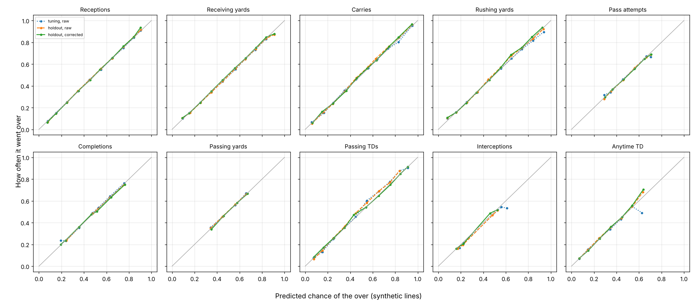

# Player props (NFL)

The player projections ([PLAYERS.md](PLAYERS.md)) give each player's expected line. This
work turns those means into calibrated chances for prop bets, over/under and anytime
touchdown, compares them with the books' prices, and flags a bet only when the edge is
real. NFL only for now; college is not done (Ryan's call, Oct 2026).

Code: `nflmodel/propdist.py` (distributions), `nflmodel/props.py` (the prop model),
`nflmodel/propsim.py` (same-game combinations), `nflmodel/oddsapi.py` (prices),
`nflmodel/propmarket.py` (vig, edge, EV, flags, stakes), `nflmodel/proplog.py` (the log),
`run_props.py` (the command line), `experiments/props_calibration.py` (choosing the
methods, the calibration report, the fitted parameters in `data/prop_params.json`).

**Status (Oct 27, 2026):** calibrated against outcomes (below), but **against real 2025
DraftKings and FanDuel lines the model is worse than the books**, and the sides it would
have flagged broke even. Flags are paused (`propmarket.FLAGS_ON = False`); every side is
still priced and logged. The board shows nothing new.

**Market-only tags (Oct 29, 2026):** with the flags off, the Props section shows two chips
that need no model opinion (`propmarket.market_tags`): a **book gap** when DraftKings and
FanDuel post a main line a full step apart (the over at the lower line and the under at the
higher are the better numbers; a **middle** when both are −110 or better), and a **ladder gap**
when a rung's no-vig chance at a book is more than 5 points off what its own main line
implies through the model's distribution. They are kept in `data/props/prop_log_tags.csv`
by `row_id` (append-only). Nothing is flagged or staked on them; see FEATURES.md, "Edge
tests, late October 2026".

## From a mean to a chance

| Stat | Distribution |
|---|---|
| Receptions, carries, pass attempts, completions, interceptions | Negative binomial: the spread around the mean grows with the mean and depends on the size of the role (target or carry share) |
| Passing TDs, anytime TD | The same; it fits to Poisson where results vary no more than Poisson allows (passing TDs) |
| Receiving, rushing, passing yards | Volume times yards per play: the volume (receptions, carries, completions) is the count distribution above, and given n plays the yards are a gamma with n times a per-play shape. Zero plays is zero yards |

Every stat also carries a small fitted chance the player leaves early or loses his role
(injury, blowout, benching): a second component with a fraction of the usual volume. It
mostly fattens the low end. The mean is kept equal to the projection.

Outcomes are whole numbers, so lines settle the way books settle them: on a half-point line
there is no push; on a whole-number line the push chance is reported separately.

Chosen on the tuning seasons (`--select`, leave one season out), by Brier score and log
loss at the test lines:

- Counts: negative binomial with the early-exit component matched or beat Poisson, Poisson
  with exit, and negative binomial without exit on every count stat (receptions: Brier
  0.1918 against 0.1944 for plain Poisson, wide receivers; carries 0.2096 against 0.2272).
- Yards: volume times yards per play beat a gamma with a separate chance of zero for
  receivers (0.2158 against 0.2179), tight ends, quarterback rushing and passing yards
  (0.2375 against 0.2389). For running backs the two were within 0.0003 of each other;
  the compound is used for all, so every yards prop works the same way.

A monotone correction (isotonic) fitted on the tuning seasons only sits on top. It changes
almost nothing (below), because the distributions come out calibrated by themselves.

## Seasons and lines

- Tuning: 2013-2018 (the player model's tuning seasons). Each season scored with
  distribution widths fitted on the other five.
- Holdout: 2019 through week 7 of 2026, run once. Each season scored with widths fitted on
  the seasons before it (what the board would have had) and the correction fitted on the
  tuning seasons only. Nothing was changed after seeing it.
- Rows: players a book would post the prop for, chosen only on what was known before the
  game (an active player whose projection clears a minimum; quarterbacks, the projected
  starter), and the books' rule that a prop is void if the player does not play.
- **Every line here is synthetic.** There are no past prop prices. Each player-game is
  scored at the half-point line nearest his projection (yards rounded to fives, as books
  do) and one and two steps either side (1 catch or carry, 2 attempts or completions, 10
  rushing or receiving yards, 15 passing yards); touchdowns and interceptions at the
  standard 0.5, 1.5 and 2.5. Real lines enter only through the live log.

## Calibration

Brier score, lower is better. Baselines: the same distributions built on the player's
season average, and the share of his last 8 games over the line. Differences are the
model (with the correction) minus the baseline, with one standard error clustered by game.

**Holdout, 2019-2026**

| Stat | Lines | Games | Model | vs season average | vs last 8 games |
|---|---|---|---|---|---|
| Receiving yards | 131,729 | 2,067 | 0.2065 | −0.0135 ± 0.0006 | −0.0168 ± 0.0005 |
| Receptions | 131,650 | 2,067 | 0.1863 | −0.0107 ± 0.0005 | −0.0138 ± 0.0004 |
| Rushing yards | 54,288 | 2,067 | 0.2058 | −0.0123 ± 0.0009 | −0.0201 ± 0.0009 |
| Carries | 47,712 | 2,067 | 0.1989 | −0.0127 ± 0.0009 | −0.0202 ± 0.0009 |
| Passing yards | 18,340 | 2,035 | 0.2366 | −0.0244 ± 0.0021 | −0.0216 ± 0.0019 |
| Pass attempts | 18,340 | 2,035 | 0.2316 | −0.0214 ± 0.0021 | −0.0202 ± 0.0018 |
| Completions | 18,340 | 2,035 | 0.2161 | −0.0208 ± 0.0019 | −0.0188 ± 0.0015 |
| Passing TDs | 11,004 | 2,035 | 0.1807 | −0.0197 ± 0.0017 | −0.0163 ± 0.0013 |
| Interceptions | 7,336 | 2,035 | 0.1931 | −0.0212 ± 0.0019 | −0.0176 ± 0.0016 |
| Anytime TD | 39,300 | 2,067 | 0.1428 | −0.0097 ± 0.0005 | −0.0125 ± 0.0005 |

**Tuning, 2013-2018** (each season with widths fitted on the other five)

| Stat | Lines | Games | Model | vs season average | vs last 8 games |
|---|---|---|---|---|---|
| Receiving yards | 101,388 | 1,554 | 0.2100 | −0.0086 ± 0.0007 | −0.0164 ± 0.0006 |
| Receptions | 100,542 | 1,554 | 0.1896 | −0.0075 ± 0.0006 | −0.0141 ± 0.0005 |
| Rushing yards | 40,343 | 1,554 | 0.2078 | −0.0087 ± 0.0011 | −0.0175 ± 0.0011 |
| Carries | 36,147 | 1,554 | 0.2040 | −0.0100 ± 0.0012 | −0.0185 ± 0.0011 |
| Passing yards | 13,920 | 1,538 | 0.2374 | −0.0168 ± 0.0022 | −0.0220 ± 0.0022 |
| Pass attempts | 13,920 | 1,538 | 0.2326 | −0.0168 ± 0.0022 | −0.0182 ± 0.0021 |
| Completions | 13,920 | 1,538 | 0.2134 | −0.0145 ± 0.0019 | −0.0172 ± 0.0017 |
| Passing TDs | 8,352 | 1,538 | 0.1787 | −0.0163 ± 0.0018 | −0.0162 ± 0.0016 |
| Interceptions | 5,568 | 1,538 | 0.2039 | −0.0185 ± 0.0022 | −0.0187 ± 0.0020 |
| Anytime TD | 30,574 | 1,554 | 0.1402 | −0.0086 ± 0.0005 | −0.0130 ± 0.0006 |

The model beats both baselines on every stat in both periods, and at every position
(`experiments/out/props_calibration.json` has the tables by stat and position, log loss,
and the predicted-against-actual bands for each).

How often the over hit, by predicted band (holdout, corrected, a sample of the tables):

| Predicted | Receptions | Receiving yards | Rushing yards | Passing yards | Anytime TD |
|---|---|---|---|---|---|
| 10-20% | 15.1% → 14.5% | 15.1% → 14.7% | 15.7% → 15.4% | | 14.8% → 14.3% |
| 30-40% | 35.2% → 35.5% | 35.1% → 35.2% | 33.6% → 33.7% | 34.9% → 33.7% | 35.1% → 36.1% |
| 45-50% | 47.6% → 46.5% | 46.0% → 46.2% | 47.5% → 49.0% | 49.7% → 50.7% | 47.2% → 47.2% |
| 60-70% | 65.4% → 65.7% | 65.3% → 65.3% | 64.6% → 68.5% | 67.2% → 66.6% | 63.8% → 70.3% (138) |
| 80-90% | 84.3% → 84.8% | 83.5% → 84.6% | 83.2% → 84.8% | | |

Each band has thousands of lines except where a count is shown. The weakest spot is
rushing yards between 55% and 70%, which went over 1-4 points more often than predicted.

**The correction.** Isotonic, fitted on the tuning seasons. On the holdout it moves the
Brier score by less than 0.0002 on every stat, in both directions. It is kept as a guard,
not because it is doing work.

**Pushes on whole-number lines** (the integer nearest the projection; 2019 and 2025):
predicted against actual, receptions 18.8% / 19.2% (WR, 2019), passing TDs 31.2% / 31.5%,
receiving yards 1.2% / 1.1%. The weakest: running-back carries, 6.6% predicted against
8.6% in 2019 (7.5% in 2025).

**At a line set at the player's recent median** (his last 8 games, at least 4): the side
the model favours won 60-63% of the time on the holdout for yards, catches and attempts,
against a 50% coin flip. **This is not evidence the model beats books.** A recent median
is a naive line; books set theirs with the same information and more. It shows the model
knows more than a player's recent median, nothing more. The only test against real lines
is the live log.

**Not shown profitable.** None of the results above uses a price. Nothing in the tuning or
holdout seasons says these props make money.

## Against real lines: 2025

`experiments/props_real_lines.py`, on the 2025 backfill (278 games, DraftKings and
FanDuel, passing, rushing and receiving yards; two-sided markets, pushes left out, each
book's line counted separately). Distribution widths fitted on seasons before 2025.

| Snapshot | Props | Brier, ours | Brier, books (vig-free) | Ours minus books |
|---|---|---|---|---|
| Pricing (first daily run within 3 days), pregame projections | 6,217 | 0.2547 | 0.2500 | +0.0047 ± 0.0018 |
| Close (10 minutes before kickoff) | 9,138 | 0.2574 | 0.2500 | +0.0074 ± 0.0016 |

By stat at the pricing snapshot: passing yards +0.0042 ± 0.0034, receiving yards
+0.0066 ± 0.0023, rushing yards +0.0012 ± 0.0033. **The books' prices are the better
forecast, at both snapshots.** Where the model disagreed with them, the results sided
with the books: lines the model put at 60-70% went over 49% of the time (256 lines), and
lines it put at 30-40% went over 44% (1,200 lines).

**The bets the live rules would have flagged** at the pricing snapshot: 1,486 bets,
790-696, **return +0.5% ± 2.7%** against an average claimed EV of +14.9%. By stat:
passing yards −8.8% ± 6.5% (213 bets), receiving yards −0.6% ± 3.3% (820), rushing yards
+6.8% ± 4.6% (453). Two-thirds were unders. Indistinguishable from zero, and nowhere
near what the edges claimed.

**Line movement.** For those bets, the closing line moved toward the model's side 58% of
the time and away 32%, by +0.96 ± 0.10 points on average (1,484 bets). Across every prop,
on the side the model preferred, it moved toward us 47% and away 43% (+0.21 ± 0.06 points,
3,285 props). Where the line did not move (475 bets), the closing price gave the bet an EV
of −5.4%, the vig.

**Without the week's news (Oct 27, 2026).** The numbers above use pregame projections:
`players.build(pregame=True)` judges who plays from the previous week's roster, with no
injury report or game-day inactives for the week, and the game model runs without the
week's starting quarterbacks or injuries. The first version of this test used the game-day
projections, which know each game's inactives; the results barely changed:

| Pricing snapshot | Game-day projections | Pregame projections |
|---|---|---|
| Brier, ours minus books' | +0.0039 ± 0.0018 | +0.0047 ± 0.0018 |
| Flagged bets, return | +0.4% ± 2.7% (1,486) | +0.5% ± 2.7% (1,486) |
| Lines moved toward the flag | 59% (away 31%) | 58% (away 32%) |

So the line movement was not the model knowing the injury news. One look-ahead remains in
both: the game model is anchored to the **closing** spread and total, so a player
projection already reflects moves in the game's line between the pricing snapshot and
kickoff, and props tend to move with those. That alone could produce some of the
movement toward the model. Taking it out needs the spread and total as they stood at the
pricing snapshot (the backfill has only player props; the nfelo file has opening spreads
but no opening totals).

**A market-anchored blend** (book's chance + w x (ours - book's)) did a little better than
the books alone at w = 0.2-0.3 (Brier 0.2492 against 0.2500 at the pricing snapshot), but
that weight was picked on the same season it is scored on, at the snapshot with the
look-ahead, so it proves nothing yet.

**What this means.** The model knows far more than a player's averages (the calibration
above), but not more than DraftKings and FanDuel. Flags are paused. To earn them back:

1. Projections as of the pricing snapshot: done (pregame projections, above). Still to
   take out: the closing spread and total in the game model.
2. Fit the blend weight on one season of real lines and test it on another: backfill
   2024 (about 16,000 credits, next month), fit on 2024, test on 2025.
3. Turn flags back on only if the blend beats the books' prices out of sample, with the
   closing line value to match.

## Same-game combinations

`nflmodel/propsim.py`. A Gaussian copula: each leg keeps its own distribution (so single
props are untouched) and each pair of legs gets a correlation by kind of pair, fitted on the
tuning seasons so that the chance both go over matches how often both did: the same
player's two stats, two players on a team by role (QB, R1-R3 by target share, RB1), or the
same roles on opposite teams.

Holdout, 2019-2026, the chance both legs go over at each one's middle test line
(correlations fitted on 2013-2018):

| Pair | Pairs | Correlation | Independent | Copula | Actual |
|---|---|---|---|---|---|
| QB pass yds & top receiver's rec yds | 3,820 | 0.40 | 23.1% | 29.6% | 32.1% ± 0.8 |
| QB pass yds & second receiver's rec yds | 3,820 | 0.39 | 22.6% | 28.9% | 29.7% ± 0.7 |
| Top two receivers' rec yds | 4,134 | 0.00 | 21.3% | 21.3% | 21.8% ± 0.6 |
| QB pass yds & lead back's rush yds | 3,813 | −0.09 | 22.3% | 20.9% | 22.7% ± 0.7 |
| Both quarterbacks' pass yds | 1,771 | 0.14 | 24.5% | 26.6% | 27.4% ± 1.1 |
| QB pass TDs (over 0.5) & top receiver anytime TD | 3,809 | 0.87 | 22.4% | 28.9% | 33.8% ± 0.8 |
| Same player: receptions & rec yds | 15,747 | 0.86 | 20.4% | 36.5% | 36.8% ± 0.4 |
| Same player: carries & rush yds | 4,119 | 0.84 | 20.8% | 36.4% | 39.8% ± 0.8 |
| Same player: rec yds & anytime TD | 15,636 | 0.50 | 12.5% | 18.8% | 19.1% ± 0.3 |
| QB completions & pass yds | 3,820 | 0.71 | 24.2% | 36.9% | 39.3% ± 0.8 |
| Three legs: QB pass yds, top two receivers' yds | 3,820 | | 10.5% | 16.5% | 17.7% |

Over all 1.3 million holdout pairs with a fitted correlation, the Brier score falls from
0.1652 treating legs as independent to 0.1637 with the copula. Treating legs as
independent badly understates stacks; the copula gets most of the way, but it still runs
1-5 points short on the tightest pairs (a quarterback's touchdowns with his top
receiver's, a back's carries with his yards), because the correlations are shrunk toward
zero and fitted at one line. Price those combinations as a little more likely than shown.
An earlier version, with two shared factors per team instead of one correlation per kind
of pair, was further off (27% against 32% for the first pair) and was replaced.

Combinations are priced on request (`propsim.combo_prob`); the books' same-game prices are
not in The Odds API's free data, so none are flagged.

## Market prices (The Odds API)

- Key: the `ODDS_API_KEY` repository secret. Never written to a file or a log.
- Plan: 20,000 credits a month (Oct 2026). Cost per call: (markets returned) x (regions)
  for live odds; 10 x that for historical odds; one to ten named books count as one region,
  so DraftKings and FanDuel cost the same as ten books; an empty response costs nothing;
  the live events list is free, the historical one 1 credit. Every call's cost and the
  credits left go to `data/props/api_usage.csv`, and no call is made that could leave fewer
  than 200 (`PROPS_RESERVE`).
- Books: DraftKings and FanDuel only (Ryan's call, Oct 2026; `PROPS_BOOKS` to change).
- Markets: all ten the model prices (pass, rush and receiving yards, receptions, carries,
  pass attempts, completions, pass TDs, interceptions, anytime TD), plus the alternate
  ladders for the three yardage props (200+, 225+, 250+ ...; added Oct 27, 2026: Ryan bets
  lower rungs more than the main line). Each rung is priced from the same distribution as
  the main line. Rungs posted over-only assume a 10% two-way margin (`ALT_MARGIN`), to be
  checked against rungs with both sides once the log has them. `PROPS_MARKETS` to change.
- **Live, three snapshots per game** (`.github/workflows/props.yml`):
  - open: the first daily run (12:47 UTC) once props are posted, kickoff 3-8 days away;
  - pricing: the first daily run with kickoff 3 days away or less (Friday for Sunday
    games, when injury reports are mostly out). **Bets are decided here only**;
  - close: runs every 10 minutes in the usual kickoff windows; the first run inside 90
    minutes of a game's kickoff takes its prices (`PROPS_CLOSE_MINUTES`). The window is
    wide because GitHub starts scheduled runs late, often by an hour or more (the Week 8
    Thursday game got no closing snapshot with a 45-minute window and runs every 30
    minutes), so the "close" is usually 10 to 90 minutes before kickoff, not the last price.
  About 15 games x 13 markets x 3 = 585 credits a week, 2,500 a month. Games on unusual
  days (Christmas, a Wednesday) may miss their closing snapshot.
- **When the API drops a call** (a reset connection, a timeout, a 429 or a 5xx), the client
  retries three times (2, 6 and 15 seconds apart). If it still fails, a scheduled run prints
  why and ends without pricing anything, so the job stays green and the next run tries
  again; any other HTTP error stops the run the same way. Nothing is logged for a failed
  call, so `api_usage.csv` only has calls that answered.
- **Backfill** (`.github/workflows/props-backfill.yml`, run by hand; `nflmodel/propbackfill.py`):
  past prices at the same two moments the live run uses, the pricing run (12:47 UTC, first
  day within 3 days) and the close (10 minutes before kickoff). Historical props start in
  May 2023. Plan agreed with Ryan (Oct 27, 2026): the 2025 season's three yardage markets
  first (about 17,100 credits, so most of the first month), then 2024 and 2023 only if
  2025 is worth it. `experiments/props_real_lines.py` then scores the model against those
  lines (above). The 2025 run used 16,062 credits (578 calls, Oct 27, 2026).

## Vig, edge, EV and flags

- **Vig-free price.** Each book's two-sided market by simple scaling and by the power
  method (which takes more of the margin from the longshot); both are logged, and the power
  method is used. When both books post the same line, the consensus is their average.
  Neither is a sharp book, so the market price here is a retail price; closing line value
  is measured against the same two books.
- **One-sided markets** (anytime TD is sometimes Yes only): an assumed two-way overround of 8%,
  applied by the power method. Once the log has 30 or more anytime-TD markets with both
  sides posted, their median overround replaces the 8%.
- **Edge** = our chance of winning (pushes set aside) minus the vig-free market chance.
- **EV** per unit at the best price posted = p(win) x payout - p(lose).
- **Flag** (paused, see "Against real lines") only when all hold:
  - edge of 5 points or more. There are no past prices to set this on. On the tuning
    seasons, at the recent-median line (yards, catches, carries, attempts), the side the
    model favoured won about 0.6-0.8 points less often than it said, whatever the size of
    the gap (65.3% predicted against 64.6% won where it was 5 points or more from 50%;
    47,860 lines). So its confidence runs slightly ahead of it, by less than a point, and a
    5-point minimum leaves room for that; it is a starting value, to be set from the live
    closing line value and the backfill.
  - positive EV at the best price;
  - liquid: both DraftKings and FanDuel post the player's market (their lines may differ
    by a half point; each line is priced against its own book), a hold of 10% or less, and
    a price between -400 and +400;
  - role clear: no designation beyond Probable, at least 4 weighted games of history,
    usage not moved more than 25% by teammates' absences, and for quarterbacks the
    projected starter. Players Out, Doubtful or on injured reserve already have no
    projection.
- **Stakes:** a quarter of the Kelly stake at our chance, at most 1% of bankroll per prop
  and 3% per game (scaled down together when a game's flags add up to more).

## On the board

The NFL board's **Props** section (`#props`, NFL only) shows each week from the log:
every main line and ladder rung with DraftKings' and FanDuel's prices, our chance, the
books' no-vig chance and the lean; select a player for his whole ladder; the closing line
and the result once played. Below that, what went right and what was off (the biggest
disagreements with the books, and which way they came out), calibration of our chances and
the books' by band, and a week-by-week table. Past weeks stay selectable. The files are in
`docs/props/`, rebuilt by `nflmodel/propboard.py` on every props run, and fetched when the
section opens (so it works on the published site, not from a copy opened from disk).

## The log

`data/props/`, committed by the **Player props** Action (`.github/workflows/props.yml`):

- `prop_log.csv` append-only: every side priced at every snapshot (open, pricing, close;
  time, player, game, market,
  line, each book's prices, vig-free chance both ways, ours, edge, EV, stake, flagged, why
  not). Rows are never edited.
- `prop_results.csv` append-only: the result of each priced side (void if he did not
  play), and for flagged bets the closing price and closing line value (EV of our price at
  the closing vig-free chance; if the line moved, the closing chance is carried to our
  line with the model's own difference between the two lines).
- `weekly_summary.csv`, `summary.json`: record, units, return, average closing line value,
  share of bets that beat the close, and calibration of every live probability so far.
- `snapshots.csv`, `api_usage.csv`: which games have had which snapshot, and credits.
- `history/<season>/`: past prices from the backfill, one file per game and snapshot.

Results come from the board's box-score and availability caches, which **Update board**
refreshes daily.

## Inputs, guardrails and limits

- The props use the projections as the board builds them, so everything that moves them
  moves the props: starting quarterback changes, Out and Doubtful players and
  `data/overrides.csv`, wind forecasts and game script (projected margin and total).
- No look-ahead: probabilities depend only on pre-game projection columns, the
  recent-games baseline only on earlier games, and no game is priced after kickoff
  (`tests/test_props.py`).
- Pass and rush TDs are projected separately but the anytime-TD prop uses their sum;
  quarterback anytime TD is rushing only.
- Not modelled: longest-play props, quarter props. Alternate ladders for receptions,
  carries and the like are not fetched.
- Low ladder rungs are high-probability bets (often -300 or shorter), where a small error
  in our chance is a large error in EV. On the holdout the model was well calibrated up to
  80-90% (receiving yards: 83.5% predicted, 84.6% happened) but slightly overconfident at
  90-95% (90.8% against 87.8%, 123 lines). Rungs far below the projection were not tested.
- College: not started.
